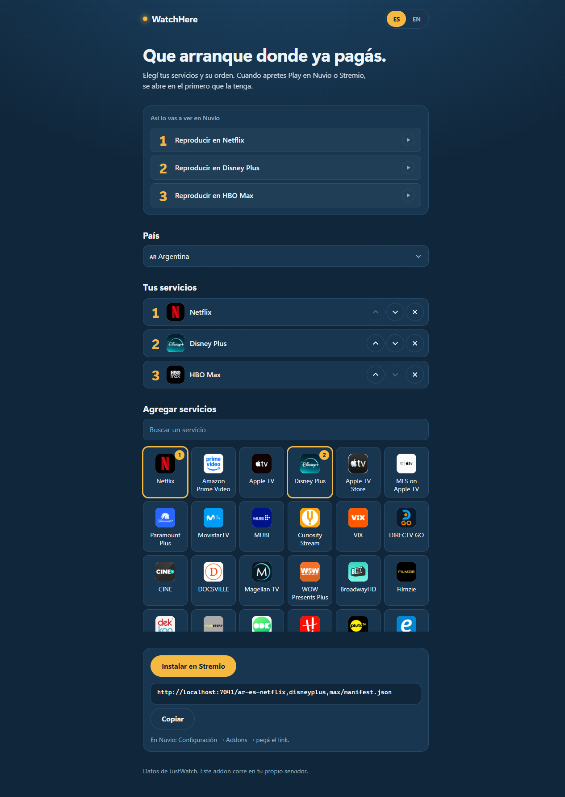

# WatchHere

A self-hostable [Stremio](https://www.stremio.com/) / Nuvio stream add-on that answers one question for the title you
picked: **is this on a streaming service I already pay for, and if so, what is the link that plays it there?**

It looks the title up on JustWatch (by IMDb id, never by name), keeps only the services **you** chose, in **your**
order, and answers one stream per service with an https link that starts playback in that service's app.



## Why not WatchHub?

WatchHub (the official Stremio add-on) is the obvious tool for this, but it falls short in three ways:

1. Its links open the title's **page** in the streaming app (Disney+ `/browse/...`, Netflix `/title/...`), so the app
   opens and nothing plays. WatchHere uses the **play** links (Disney+ `/play/<id>`, Netflix `/watch/<id>`, HBO Max
   `/video/watch/<id>`...), and the exact episode when the service has per-episode links.
2. Its data has gaps and mixes countries. WatchHere asks JustWatch about the country you configured and nothing else.
3. It lists every service. In an autoplay client the first stream wins, so a service you don't pay for can win and
   leave the TV stuck. WatchHere answers **only** the services you ticked, and when the title is on none of them it
   answers nothing, so your other sources take over.

## What it does and does not do

- Movies and episodes (`tt...` ids and, with a TMDB key, `tmdb:...` ids). Subscription and free (with ads) offers
  only; no rent or buy.
- Services that only have a page link (no play link) are still answered, but always **after** every play link, so a
  page link never wins autoplay over a link that plays.
- Netflix only exposes a show-level id, so a Netflix row opens the show (Netflix resumes where you left off). For
  other services, if JustWatch's episode doesn't agree with Cinemeta's (air date or numbering), it falls back to the
  show link rather than risk the wrong episode.
- No catalogs, no scraping, no torrents, no debrid, no account and no secret to run it.
- It never answers an error: if JustWatch is slow or down, the list is empty and your client moves on.

## Install with Docker

```sh
git clone https://github.com/cayatecayote/watchhere.git watchhere && cd watchhere
cp docker-compose.example.yml docker-compose.yml
docker compose up -d --build
curl http://localhost:7020/health        # {"ok":true,"version":"0.1.0"}
```

Or without Compose:

```sh
docker build -t watchhere .
docker run -d --init --name watchhere --restart unless-stopped -p 7020:7020 watchhere
```

Without Docker you need Node.js 22 or newer and no `npm install` (there are no dependencies): `npm start`.

### Environment variables

| Variable | Default | What it is |
|---|---|---|
| `PORT` | `7020` | Port the server listens on. |
| `DEFAULT_CONFIG` | `ar-es-disneyplus,netflix` | Configuration used when the URL has none (see below). An invalid value stops the server at start. |
| `TMDB_API_KEY` | empty | Optional. Needed only for `tmdb:` ids; without it those ids answer nothing. |

### Routes

| Route | What |
|---|---|
| `/configure` | The configure page (blank). `/<config>/configure` opens it pre-filled. |
| `/manifest.json` | Manifest using `DEFAULT_CONFIG`. |
| `/<config>/manifest.json` | Manifest for one configuration: **this is the install link**. |
| `/<config>/stream/<type>/<id>.json` | Streams for a movie or episode (`tt1234567`, `tt1234567:2:5`). |
| `/api/packages?country=ar` | The services JustWatch lists for a country (used by the page). |
| `/health` | `{"ok":true,"version":"..."}`. |

## Configure and install

Open `http://<your-server>:7020/configure`. Pick your **country**, tick your services (the page lists every service
JustWatch has for that country), put them in order, and copy the install link or press "Install in Stremio". The page
switches between English and Spanish.

The whole configuration lives in the install URL, in one path segment before `manifest.json`:

```
http://<your-server>:7020/ar-es-netflix,disneyplus,max/manifest.json
                          |  |  '-------------+-------'
                   country   language    services, in your order
                                         (JustWatch technical names)
```

There is no server-side state, so every Nuvio profile can have its own link (for instance, the kids' profile without
HBO Max). An invalid configuration segment is a 404, never a silent default, and so is a country that is not in the
list on the configure page (`src/countries.js`).

### Nuvio

Paste the install link in Nuvio's add-ons. The manifest name is always "WatchHere" whatever the configuration, so you
can pick it by name.

WatchHere rows **autoplay** only in a Nuvio build whose autoplay accepts external links, and only when WatchHere is
picked by name in the autoplay add-on list. In any other Nuvio build the WatchHere row is a normal row that you tap by
hand (it still opens the title in the right app).

### Stremio

Press "Install in Stremio" on the configure page, or paste the link in the add-on catalog. In Stremio the WatchHere
row is tappable: it opens the title in the streaming app.

**Stremio only installs add-ons served over https** (the one exception is `localhost`). A plain
`http://192.168.x.x:7020` link will not install, so put WatchHere behind a reverse proxy with a certificate (Caddy,
nginx, Traefik) or a tunnel (Cloudflare Tunnel, Tailscale Funnel) and open the configure page from that https address:
the install link is built from the address you opened it on.

Disney+ and Netflix always ask for a profile on a cold start; nothing can skip that.

## Please self-host, don't run a public instance

WatchHere talks to JustWatch's GraphQL API. That API is **unofficial**: it has no key, no documented limits and no
promise that it stays as it is. Traffic from one household is a few requests a day and goes unnoticed; one public
instance serving many people would be rate-limited or blocked, and then fail for everyone. Run your own: it is one
small container, carries no secrets, and keeps its own traffic small (answers are cached in memory, and one lookup is
shared by every configuration).

Title data comes from [Cinemeta](https://v3-cinemeta.strem.io), the same free source Stremio uses. Availability data
comes from JustWatch; WatchHere is not affiliated with either.

## Link builders

Which services have the title (JustWatch) and how to open it are separate concerns. `src/links.js` exports `BUILDERS`:
an ordered list of functions `(offer) => { url, kind } | null`, where `kind` is `'play'` (it starts playback) or
`'page'` (it only opens the title's page). For each offer, the first builder that answers wins. `offer` is the
JustWatch offer (`monetizationType`, `standardWebURL`, `deeplinkURL`, `package.technicalName`, `package.clearName`).

v1 ships one builder, `justWatchBuilder`. It unwraps JustWatch's Android TV deep link
(`intent://HOST/PATH#Intent;...;scheme=https;...`) into the https link it wraps (a `play` link), and falls back to
`standardWebURL` (a `page` link). Only http(s) links are ever answered.

To add one for a service whose app accepts a link JustWatch doesn't give you, put it before the default:

```js
// src/links.js
function myServiceBuilder(offer) {
  if (offer.package?.technicalName !== 'myservice') return null; // not mine: let the next builder try
  const id = /\/title\/(\d+)/.exec(offer.standardWebURL ?? '')?.[1];
  return id ? { url: `https://www.myservice.com/play/${id}`, kind: 'play' } : null;
}

export const BUILDERS = [myServiceBuilder, justWatchBuilder];
```

Add a test in `test/links.test.js`. Matching and ordering don't change.

## Development

```sh
npm test        # offline: no network, fake fetch
npm run live    # real JustWatch + Cinemeta (the only place the network is used)
```

## License

MIT. See [LICENSE](LICENSE).

---

# En español

WatchHere es un add-on de streams para [Stremio](https://www.stremio.com/) y Nuvio que podés alojar vos mismo. Le
contesta una sola pregunta al título que elegiste: **¿está en un servicio de streaming que ya pagás y, si está, cuál es
el link que lo reproduce ahí?**

Busca el título en JustWatch (por id de IMDb, nunca por nombre), se queda solo con los servicios que **vos** elegiste,
en **tu** orden, y responde un stream por servicio con un link https que arranca la reproducción en la app de ese
servicio.


## ¿Por qué no WatchHub?

WatchHub (el add-on oficial de Stremio) es lo obvio, pero se queda corto en tres cosas:

1. Sus links abren la **página** del título en la app (Disney+ `/browse/...`, Netflix `/title/...`): la app se abre y
   no reproduce nada. WatchHere usa los links de **reproducción** (Disney+ `/play/<id>`, Netflix `/watch/<id>`, HBO
   Max `/video/watch/<id>`...) y el episodio exacto cuando el servicio tiene links por episodio.
2. Sus datos tienen huecos y mezclan países. WatchHere le pregunta a JustWatch por el país que configuraste y nada más.
3. Lista todos los servicios. En un cliente con autoplay gana el primer stream, así que uno que no pagás puede ganar y
   dejarte la tele clavada. WatchHere responde **solo** los servicios que tildaste, y si el título no está en ninguno,
   no responde nada y entran tus otras fuentes.

## Qué hace y qué no

- Películas y episodios (ids `tt...` y, con una key de TMDB, ids `tmdb:...`). Solo ofertas por suscripción o gratis
  (con publicidad); nada de alquiler ni compra.
- Los servicios que solo tienen link a la página (sin link de reproducción) se responden igual, pero siempre
  **después** de todos los links que reproducen, así un link de página nunca le gana el autoplay a uno que reproduce.
- Netflix solo expone el id de la serie, así que su fila abre la serie (Netflix sigue donde la dejaste). En los demás
  servicios, si el episodio de JustWatch no coincide con el de Cinemeta (fecha de emisión o numeración), usa el link de
  la serie antes que arriesgarse a abrir otro episodio.
- Sin catálogos, sin scraping, sin torrents, sin debrid, sin cuenta y sin secretos para correrlo.
- Nunca responde un error: si JustWatch está lento o caído, la lista viene vacía y tu cliente sigue con lo suyo.

## Instalar con Docker

```sh
git clone https://github.com/cayatecayote/watchhere.git watchhere && cd watchhere
cp docker-compose.example.yml docker-compose.yml
docker compose up -d --build
curl http://localhost:7020/health        # {"ok":true,"version":"0.1.0"}
```

Sin Compose:

```sh
docker build -t watchhere .
docker run -d --init --name watchhere --restart unless-stopped -p 7020:7020 watchhere
```

Sin Docker alcanza con Node.js 22 o más nuevo y no hace falta `npm install` (no tiene dependencias): `npm start`.

### Variables de entorno

| Variable | Por defecto | Qué es |
|---|---|---|
| `PORT` | `7020` | Puerto en el que escucha. |
| `DEFAULT_CONFIG` | `ar-es-disneyplus,netflix` | Configuración que se usa cuando la URL no trae ninguna. Si es inválida, el servidor no arranca. |
| `TMDB_API_KEY` | vacía | Opcional. Solo hace falta para ids `tmdb:`; sin ella esos ids no responden nada. |

### Rutas

| Ruta | Qué es |
|---|---|
| `/configure` | La página de configuración (en blanco). `/<config>/configure` la abre ya completada. |
| `/manifest.json` | Manifest con `DEFAULT_CONFIG`. |
| `/<config>/manifest.json` | Manifest de una configuración: **este es el link de instalación**. |
| `/<config>/stream/<tipo>/<id>.json` | Streams de una película o episodio (`tt1234567`, `tt1234567:2:5`). |
| `/api/packages?country=ar` | Los servicios que JustWatch lista para un país (los usa la página). |
| `/health` | `{"ok":true,"version":"..."}`. |

## Configurar e instalar

Abrí `http://<tu-servidor>:7020/configure`. Elegí el **país**, tildá tus servicios (la página lista todos los que
JustWatch tiene para ese país), ordenalos y copiá el link de instalación o apretá "Instalar en Stremio". La página
cambia entre español e inglés.

Toda la configuración vive en el link de instalación, en un segmento del path antes de `manifest.json`:

```
http://<tu-servidor>:7020/ar-es-netflix,disneyplus,max/manifest.json
                          |  |  '-------------+-------'
                      país   idioma    servicios, en tu orden
                                       (nombres técnicos de JustWatch)
```

No hay estado en el servidor, así que cada perfil de Nuvio puede tener su propio link (por ejemplo, el perfil de los
chicos sin HBO Max). Un segmento de configuración inválido da 404, nunca un valor por defecto en silencio, y lo mismo
un país que no está en la lista de la página de configuración (`src/countries.js`).

### Nuvio

Pegá el link de instalación en los add-ons de Nuvio. El nombre del manifest es siempre "WatchHere", cualquiera sea la
configuración, así que lo podés elegir por nombre.

Las filas de WatchHere hacen **autoplay** solo en un build de Nuvio cuyo autoplay acepte links externos, y solo si
WatchHere está elegido por nombre en la lista de add-ons de autoplay. En cualquier otro build de Nuvio la fila de
WatchHere es una fila común que tocás a mano (igual abre el título en la app correcta).

### Stremio

Apretá "Instalar en Stremio" en la página de configuración, o pegá el link en el catálogo de add-ons. En Stremio la
fila de WatchHere se toca y abre el título en la app de streaming.

**Stremio solo instala add-ons servidos por https** (la única excepción es `localhost`). Un link
`http://192.168.x.x:7020` pelado no se instala, así que poné WatchHere detrás de un reverse proxy con certificado
(Caddy, nginx, Traefik) o de un túnel (Cloudflare Tunnel, Tailscale Funnel) y abrí la página de configuración desde esa
dirección https: el link de instalación se arma con la dirección desde la que la abriste.

Disney+ y Netflix siempre piden el perfil en un arranque en frío; eso no lo puede saltear nadie.

## Por favor, alojalo vos: no armes una instancia pública

WatchHere le habla a la API GraphQL de JustWatch. Esa API es **no oficial**: no tiene key, no documenta límites y nadie
promete que siga igual. El tráfico de una casa son unos pocos pedidos por día y pasa desapercibido; una instancia
pública con mucha gente se toparía con límites o bloqueos, y le fallaría a todos. Corré la tuya: es un contenedor
chico, no lleva secretos y mantiene su tráfico bajo (las respuestas se cachean en memoria y una misma consulta sirve a
todas las configuraciones).

Los datos de los títulos vienen de [Cinemeta](https://v3-cinemeta.strem.io), la misma fuente gratuita que usa Stremio.
La disponibilidad viene de JustWatch; WatchHere no tiene relación con ninguno de los dos.

## Constructores de links

Dónde está un título (JustWatch) y cómo abrirlo son cosas separadas. `src/links.js` exporta `BUILDERS`: una lista
ordenada de funciones `(offer) => { url, kind } | null`, donde `kind` es `'play'` (arranca la reproducción) o `'page'`
(solo abre la página del título). Para cada oferta gana el primer constructor que responda. `offer` es la oferta de
JustWatch (`monetizationType`, `standardWebURL`, `deeplinkURL`, `package.technicalName`, `package.clearName`).

La v1 trae un solo constructor, `justWatchBuilder`. Desenvuelve el deep link de Android TV de JustWatch
(`intent://HOST/PATH#Intent;...;scheme=https;...`) hasta el link https que contiene (un link `play`) y, si no hay,
cae a `standardWebURL` (un link `page`). Solo se responden links http(s).

Para sumar uno de un servicio cuya app acepta un link que JustWatch no da, ponelo antes del que viene por defecto:

```js
// src/links.js
function myServiceBuilder(offer) {
  if (offer.package?.technicalName !== 'myservice') return null; // no es mío: que pruebe el siguiente
  const id = /\/title\/(\d+)/.exec(offer.standardWebURL ?? '')?.[1];
  return id ? { url: `https://www.myservice.com/play/${id}`, kind: 'play' } : null;
}

export const BUILDERS = [myServiceBuilder, justWatchBuilder];
```

Sumá un test en `test/links.test.js`. El matching y el orden no cambian.

## Desarrollo

```sh
npm test        # offline: sin red, fetch falso
npm run live    # JustWatch y Cinemeta reales (el único lugar donde se usa la red)
```

## Licencia

MIT. Mirá [LICENSE](LICENSE).
